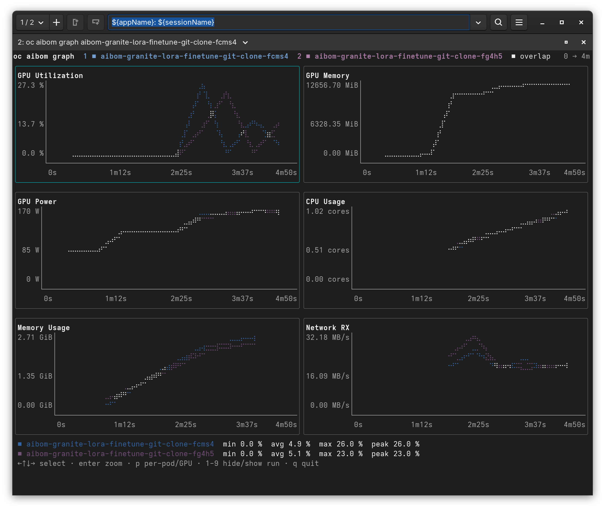

<p align="center">
  
</p>

<h1 align="center">oc-aibom</h1>

<p align="center"><strong>List, inspect, diff and compare AIBOMs from the terminal</strong></p>

<p align="center">
  <a href="https://gavinsan33.github.io/project-aibom/oc-aibom/"></a>
  <a href="https://github.com/gavinsan33/oc-aibom/releases/latest"></a>
  <a href="https://github.com/gavinsan33/oc-aibom/blob/main/go.mod"></a>
  <a href="https://github.com/gavinsan33/oc-aibom/blob/main/LICENSE"></a>
</p>

A `kubectl`/`oc` plugin for browsing, filtering and comparing the `AIBOM`
custom resources that
[aibom-webhook-service](https://github.com/gavinsan33/aibom-webhook-service)
records for each AI workload run, without digging through
`oc get aibomrun -o yaml`. It also verifies each AIBOM's signature. It uses only
the standard Kubernetes API, and works the same with `kubectl` as with `oc`.

**Full documentation lives on the [docs site](https://gavinsan33.github.io/project-aibom/oc-aibom/).** This README only
covers what the plugin does and how to install it.

## Install

With [krew](https://krew.sigs.k8s.io/), using this repo as its own plugin index:

```sh
oc krew index add oc-aibom https://github.com/gavinsan33/oc-aibom.git
oc krew install oc-aibom/aibomrun
```

Or from source (Go 1.22+), which also installs shell completion:

```sh
make install
```

Upgrading from the old `oc aibom` name? Remove that plugin first; see
[Upgrading](https://gavinsan33.github.io/project-aibom/oc-aibom/install/#upgrading-from-oc-aibom).

## Usage

```sh
oc aibomrun                               # interactive browser over the list
oc aibomrun list -A --model=granite-3.0-8b
oc aibomrun describe <name>               # readable summary, with signature check
oc aibomrun compare <name> <name> [...]   # side-by-side fields and performance
oc aibomrun diff <name-a> <name-b>        # only what differs
oc aibomrun graph <name> [<name>...]      # stored telemetry, overlaid per run
```

It accepts the usual connection flags (`-n`, `-A`, `--context`, `--kubeconfig`, ...).

Run with no subcommand on a terminal, it opens an interactive browser:

| Key | Action |
|-----|--------|
| `↑` `↓`, `k` `j` | Move the cursor (`home`/`end`, `G` jump to ends) |
| `←` `→`, `h` `l` | Scroll a wide table sideways |
| `space` | Select / deselect the row |
| `enter` | Describe the row, or compare when two or more are selected |
| `g` | Graph the selection (or the row under the cursor) |
| `s` | Open the sort menu |
| `f`, `/` | Open the live filter prompt |
| `esc` | Clear the selection |
| `q`, `ctrl+c` | Quit |

Inside describe, compare and graph, `d` and `g` switch between the detail and
graph views, and `q`/`esc` goes back to the list. The graph view has its own
keys; see [graph](https://gavinsan33.github.io/project-aibom/oc-aibom/usage/graph/#keys).



## Documentation

- [Install](https://gavinsan33.github.io/project-aibom/oc-aibom/install/): krew, source builds, shell completion, upgrading
- [list](https://gavinsan33.github.io/project-aibom/oc-aibom/usage/list/): filters, sorting, and the interactive browser's keys
- [describe](https://gavinsan33.github.io/project-aibom/oc-aibom/usage/describe/): every section, and what each signature and telemetry status means
- [diff and compare](https://gavinsan33.github.io/project-aibom/oc-aibom/usage/diff-compare/)
- [graph](https://gavinsan33.github.io/project-aibom/oc-aibom/usage/graph/): the chart view, its keys, and text output
- [Flags](https://gavinsan33.github.io/project-aibom/oc-aibom/reference/flags/)
- [Development](https://gavinsan33.github.io/project-aibom/oc-aibom/reference/development/): Makefile targets, project layout, releasing
